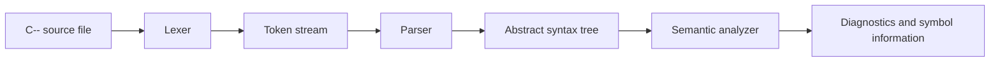

# Lesson 1: Compiler Overview and Project Boundary

This lesson gives you the map of the project before we zoom in on individual phases. The key idea is to understand what the compiler accepts, what it produces, and where its work stops.

## 1. What This Project Does

C-- is a small statically typed language. Its compiler is written in C++20 and implements the **front end** of a compiler:

1. Read a `.cmm` source file.
2. Convert its characters into tokens.
3. Parse those tokens into an abstract syntax tree (AST).
4. Check the AST for semantic errors, such as incompatible types or undeclared variables.
5. Report diagnostics and, on request, display intermediate information such as tokens, the AST, or the symbol table.

The current project does **not** generate machine code, bytecode, or another executable program. It also does not interpret the AST. So, for your presentation, describe it as a **compiler front end** or **compiler design prototype**. Don’t say that it compiles C-- into a runnable executable.



A production compiler may continue from the AST into optimization and code generation. Those later phases are outside this project’s current pipeline.

## 2. One Example Through the Pipeline

Consider this C-- program:

```cmm
num age = 20;
boolean adult = age >= 18;
show adult;
```

### Before lexing: source text

At this point, the program is just a sequence of characters. The compiler does not yet know that `num` is a type or that `>=` is an operator.

### After lexing: tokens

The lexer groups characters into meaningful units. Conceptually, the first line becomes:

```text
Num("num")  Identifier("age")  Equal("=")
Number("20")  Semicolon(";")
```

Each token also records its source location. The token structure in `src/token.h` stores a token’s category, its source text (`lexeme`), and its line and column.

Tokens are not yet a program structure. They are more like labeled words and symbols that the parser can recognize.

### After parsing: AST

The parser recognizes that the tokens form a variable declaration, another declaration whose value is a comparison, and a `show` statement.

A simplified view of the tree is:

```text
Program
  VarDecl: num age
    Number: 20
  VarDecl: boolean adult
    Binary: >=
      Variable: age
      Number: 18
  Show
    Variable: adult
```

This is a **tree** because relationships and nesting are explicit. The `>=` operation has two child expressions: the `age` variable and the number `18`.

The parser builds AST nodes defined in `src/ast.h`. The tree above is a simplified teaching representation; the exact printed output is available by running the compiler with `--ast`.

### After semantic analysis: checks

The semantic analyzer examines what the AST means:

- `age` is declared as `num`.
- `18` is a numeric literal.
- `age >= 18` is a valid numeric comparison and has type `boolean`.
- `adult` is declared as `boolean`, so assigning that comparison to it is valid.
- `adult` is declared before it is used in `show adult`.

For this input, the semantic checks succeed. But the compiler still has not run the program or generated an executable.

## 3. Syntax Errors Versus Semantic Errors

These two examples help separate the parser’s job from the semantic analyzer’s job.

### Syntax error

```cmm
show();
```

The `show` statement requires an expression in its parentheses. There is no expression here, so the parser cannot form a valid statement and reports a syntax error.

### Semantic error

```cmm
num score = "high";
```

The structure is syntactically valid: it is a declaration with an initializer. But the initializer is a `word` (text), while `score` is declared as `num`. The semantic analyzer reports the type mismatch.

A useful explanation for your teacher is:

> “Parsing asks whether the program has valid grammatical structure. Semantic analysis asks whether that structurally valid program follows rules such as type compatibility and variable declaration.”

## 4. How the Command-Line Driver Connects the Phases

The program entry point is `src/main.cpp`. It coordinates the work:

- Reads the source file into a string.
- Creates a `Lexer` and tokenizes the source.
- Prints tokens and exits if `--tokens` was requested.
- Creates a `Parser` and parses the tokens.
- Reports parser errors and stops if parsing failed.
- Prints the AST and exits if `--ast` was requested.
- Runs semantic analysis.
- Reports semantic errors or warnings.
- Prints the symbol table if `--sema` was requested and analysis succeeded.

You can use the command-line options to examine each stage:

```powershell
.\build\c--.exe examples\testing_ideas.cmm --tokens
.\build\c--.exe examples\testing_ideas.cmm --ast
.\build\c--.exe examples\testing_ideas.cmm --sema
```

The flags are diagnostic views into the compiler, not separate compilers. For example, `--ast` means “parse this program and print its AST”; it does not mean “execute the AST.”

## 5. What CMake Does Here

`CMakeLists.txt` describes how to build the project. CMake is the **build system configuration**, not a compiler phase for C-- source code.

- `CMAKE_CXX_STANDARD 20` requests the C++20 language standard for building the compiler itself.
- `add_library(cmm_lib ...)` groups the lexer, parser, AST printer, symbol table, and semantic analyzer into a reusable library.
- `add_executable(c--)` creates the command-line compiler program from `src/main.cpp`.
- `target_link_libraries(c-- PRIVATE cmm_lib)` connects the driver executable to the compiler-component library.
- `add_executable(cmm_test ...)` creates the test runner.
- `add_test(NAME lexer_tests COMMAND cmm_test)` registers that runner with CTest.

One small detail worth noticing: although the registered CTest entry is named `lexer_tests`, the test runner also exercises parser and semantic-analysis examples. The test name is narrower than the coverage.

## 6. Files to Associate with Each Responsibility

- `src/main.cpp`: Runs the phases in order and handles command-line options.
- `src/lexer.cpp`: Scans source characters and creates tokens.
- `src/parser.cpp`: Recognizes grammar and creates AST nodes.
- `src/ast.h`: Defines the AST node types.
- `src/ast_printer.cpp`: Displays an AST in readable text form.
- `src/sema.cpp`: Checks types and other meaning-related rules.
- `src/symbol_table.cpp`: Stores declarations and supports nested scopes.
- `tests/test_runner.cpp`: Runs example programs and checks whether the compiler accepts or rejects them.

## 7. A Presentation-Ready Summary

You can say:

> “This project is a C++20 compiler front end for C--. The driver reads a source file, the lexer converts characters into tokens, the recursive-descent parser builds an abstract syntax tree, and semantic analysis checks types and variable rules using a symbol table. The command-line options let us inspect tokens, the AST, and semantic information. The current project stops after analysis: it does not yet generate or execute machine code.”

## 8. Check Your Understanding

Try answering these without looking back:

1. What is the difference between a token and an AST node?
2. Which phase catches a missing expression in `show();`?
3. Which phase catches assigning `"high"` to a `num` variable?
4. Does `--ast` execute a program?
5. What major compiler capability is not implemented yet?

A good answer to question 5 is: **code generation or execution**.

**Next lesson:** the lexer, where we’ll follow source characters into tokens and inspect the token output for your example program.

# Lesson 2: Lexical Analysis, From Characters to Tokens

The lexer is the compiler’s first phase. Its job is to read raw source characters and group them into tokens the parser can recognize. It does **not** decide whether a whole statement is valid or whether an expression has the right types.

## 1. The Core Idea

Consider this source:

```cmm
num age = 18;
```

The lexer groups the characters into units:

```text
Num     Identifier     Equal     Number     Semicolon
```

You can think of a token as a small labeled package containing:

- **Type:** what kind of thing it is, such as `Num`, `Identifier`, or `Number`
- **Lexeme:** the exact source text, such as `num`, `age`, or `18`
- **Location:** the line and column where it begins

Those fields are defined in the `Token` struct in `src/token.h`. The lexer itself is implemented in `src/lexer.cpp`, with its class and helper declarations in `src/lexer.h`.

A token is not the meaning of a whole statement. It is the lexer’s labeled description of a small piece of source text.

## 2. How the Lexer Scans

This lexer is hand-written. It keeps track of a current position in the source string and moves through it one character at a time.

At a high level, it repeats this process:

1. Skip spaces, tabs, carriage returns, and comments.
2. Remember the start position of the next token.
3. Read a character.
4. Decide which kind of token begins there.
5. Consume any additional characters belonging to that token.
6. Store the token and its source location.
7. Continue until the source ends.
8. Add an `Eof` token to mark the end.

The lexer’s `current_` and `start_` fields track positions in the source. Its line and column fields track where it is for diagnostics and token display.

## 3. Recognizing Different Token Kinds

### Keywords and identifiers

If a token starts with a letter or underscore, the lexer consumes following letters, digits, and underscores. It then checks the resulting text against a keyword table.

For example:

```cmm
num age = 18;
```

- `num` appears in the keyword table, so it becomes a `Num` token.
- `age` is not a keyword, so it becomes an `Identifier` token.

Keywords are case-sensitive in this implementation: `num` is recognized as a keyword, while `Num` is not the same keyword.

### Numbers

The lexer consumes digits as a number. If it sees a dot **followed by a digit**, it consumes the dot and the fractional digits too.

```cmm
42       # one Number token
3.14     # one Number token
```

Both forms are `Number` tokens. The lexer does not emit separate integer and decimal token kinds. Later, the parser checks whether the number’s text contains a dot and records that distinction in the AST.

A dot by itself is not a supported token. For example, `3.` does not form a single decimal token because there is no digit after the dot.

### Strings and character literals

Double quotes start a string token:

```cmm
"hello"
```

Single quotes start a character token:

```cmm
'A'
```

The lexer checks for an unterminated string or character literal and creates an `Error` token in that case. It recognizes a backslash while scanning literals, but the parser does not fully decode escape sequences into their represented characters. That is a current implementation limitation.

### Operators and punctuation

Some tokens are recognized from one character, such as `+`, `{`, or `;`. Others require looking ahead one character:

```text
=    -> Equal       (assignment)
==    -> Equals      (equality)
<     -> Less
<=    -> LessEqual
+     -> Plus
++    -> PlusPlus
```

The lexer uses `peek()` to inspect the next character and `match()` to consume it when it matches the expected character.

The language also has word-based operators:

```text
equals      -> Equals
notequals   -> Notequals
and         -> And
or          -> Or
not         -> Not
```

For example, both `age == 18` and `age equals 18` produce an equality operator token.

A single `!` is not recognized as a standalone operator. The lexer recognizes `!=` as `Notequals`; a lone `!` produces an error token.

## 4. Comments and Newlines

The lexer skips spaces, tabs, and carriage returns.

It also skips two comment forms:

```cmm
# A line comment
```

```cmm
$ A block comment
  that may cover more than one line $
```

Newlines are handled differently from ordinary whitespace. The lexer can emit a `Newline` token, which lets the parser treat a line break as a statement terminator. Repeated newlines are collapsed rather than emitted as a long sequence. Semicolons are separate `Semicolon` tokens.

At the end of the source, the lexer adds an `Eof` token. This gives the parser an explicit marker for “there are no more tokens.”

## 5. Walkthrough: Your Example

Your example begins:

```cmm
num age = 0;
letter gender = 'm';

check((age > 18)and(gender equals 'm')){
    show "Your'e a guy!";
}
```

Its first declaration is tokenized approximately like this:

| Source text | Token type   | Why                        |
| ----------- | ------------ | -------------------------- |
| `num`       | `Num`        | Recognized keyword         |
| `age`       | `Identifier` | Name that is not a keyword |
| `=`         | `Equal`      | Assignment operator        |
| `0`         | `Number`     | Numeric literal            |
| `;`         | `Semicolon`  | Statement punctuation      |

The condition begins with tokens like these:

```text
Check  LeftParen  LeftParen  Identifier(age)  Greater  Number(18)
RightParen  And  LeftParen  Identifier(gender)  Equals  Char('m')
RightParen  RightParen  LeftBrace
```

Notice how `and` and `equals` become operator tokens even though they are written as words. Also notice that adjacent punctuation is still separated into individual tokens: `((` means two `LeftParen` tokens, not one special token.

The output can be inspected directly:

```powershell
.\build\c--.exe examples\testing_ideas.cmm --tokens
```

The token listing includes line and column, token type, and lexeme. For a newline token, the driver prints an empty lexeme column to keep the display readable.

## 6. Where the Lexer’s Responsibility Ends

The lexer can recognize that the source contains tokens such as:

```text
Num, Identifier, Equal, Number, Semicolon
```

But it does not decide whether those tokens make a valid declaration. That is the parser’s responsibility.

Similarly, the lexer can recognize `age`, but it does not know whether `age` was declared earlier. That is checked later by semantic analysis.

A useful way to explain the boundary is:

> “The lexer classifies source text into tokens. The parser determines whether those tokens form valid language structures. Semantic analysis then checks whether those structures make sense according to language rules.”

## 7. Details Worth Knowing About This Implementation

- Token categories are declared in `src/token.h`.
- Keyword spellings are mapped to token categories in `src/lexer.cpp`.
- A token’s `lexeme` is a `std::string_view` into the original source text, rather than a newly allocated copy of every token’s text.
- `foreach` and `do_until` are in the lexer’s keyword table, but the parser does not currently implement statements for them. Being recognized as a keyword does not necessarily mean the full feature is supported.
- An unterminated string produces an error token. An unterminated `$...$` block comment currently reaches the end of the source without producing its own error token.

That last point is useful to understand as an implementation detail; it is not something you need to present as a language feature.

## 8. Check Your Understanding

Try answering these in your own words:

1. What three kinds of information does a token store?
2. Why does the lexer need to look ahead when it sees `=` or `+`?
3. What is the difference between `Equal` and `Equals`?
4. Does the lexer decide whether a variable has been declared?
5. Why can’t you assume that every keyword in the lexer is a fully implemented language feature?

**Next lesson:** parsing. We’ll follow the lexer’s tokens into the recursive-descent parser and see how it builds statements, expressions, and operator precedence.

# Lesson 3: Parsing, Grammar, and Operator Precedence

The parser takes the token stream from the lexer and checks whether the tokens follow C-- grammar. As it recognizes valid constructs, it builds AST nodes. The parser does not check all meaning-related rules; those belong to semantic analysis.

The implementation is a **recursive-descent parser**: a collection of ordinary C++ functions, each responsible for a grammar rule. The parser class and its methods are declared in `src/parser.h` and implemented in `src/parser.cpp`.

## 1. The Parser’s Input and Output

The input is a vector of tokens ending in an `Eof` token. The output is a `Program`, whose statements are AST nodes. For example, the parser can recognize:

```cmm
num score = 90;
show score;
```

as a variable declaration followed by a show statement. At this stage, it can tell that the expression `score` is syntactically a variable reference. It cannot yet establish whether `score` was declared or whether its type is allowed in every context.

## 2. A Simplified Grammar

This is a teaching outline of the syntax recognized by the parser, not a formal specification of every detail:

```text
program       -> (declaration | statement)* EOF
declaration   -> "fixed"? type IDENTIFIER ("=" expression)? terminator
statement     -> show | check | until | give | stop | skip | assignment
block         -> "{" statement* "}"
assignment    -> IDENTIFIER ("=" expression | "++" | "--") terminator
show          -> "show" ("(" expression ")" | expression) terminator
check         -> "check" ("(" expression ")" | expression) block ("otherwise" block)?
until         -> "until" ("(" expression ")" | expression) block
```

Here, `terminator` means a semicolon, a newline, or (in certain positions) the end of a block or file. The parser accepts `show value;` and `show(value);`. A block, however, needs braces.

The parser’s statement dispatcher recognizes declarations, `show`, `check`, `until`, `give`, `stop`, `skip`, and identifier-led assignments. A keyword being recognized by the lexer does not automatically mean it is implemented as a parser statement: `foreach` and `do_until` are examples that are tokenized but not parsed as statements.

## 3. Recursive Descent in Practice

When the parser sees a type token such as `Num`, it calls `declaration()`. That function expects an identifier, optionally parses `=` followed by an expression, then requires a statement terminator. If the parser sees `Check`, it calls `check_stmt()`, which parses the condition and then a braced block.

An expression is parsed through a chain of methods. Each method handles one precedence level and delegates tighter-binding pieces to the next method. In this implementation, from **lowest precedence** to **highest**:

| Parser method   | Operators or expressions                    |
| --------------- | ------------------------------------------- |
| `logical_or()`  | `or`                                        |
| `logical_and()` | `and`                                       |
| `equality()`    | `equals`, `notequals`, `==`, `!=`           |
| `comparison()`  | `<`, `>`, `<=`, `>=`                        |
| `term()`        | `+`, `-`                                    |
| `factor()`      | `*`, `/`, `%`                               |
| `unary()`       | unary `-`, `not`                            |
| `primary()`     | literals, identifiers, `input`, parentheses |

This ordering means that multiplication groups more tightly than addition, and comparisons group more tightly than logical `and` and `or`.

## 4. Worked Precedence Example

Consider the expression from `examples/expr.cmm`:

```cmm
1 + 2 * 3 - (4 / 2)
```

Because `factor()` handles multiplication and division before `term()` handles addition and subtraction, the tree groups like this:

```text
(1 + (2 * 3)) - (4 / 2)
```

In a simplified AST view:

```text
Binary -
  Binary +
    Number 1
    Binary *
      Number 2
      Number 3
  Grouping
    Binary /
      Number 4
      Number 2
```

The parser’s loops build binary operators from left to right. Thus `10 - 3 - 2` groups as `(10 - 3) - 2`, not `10 - (3 - 2)`. Parentheses create a grouping node and explicitly override the default precedence.

## 5. Parsing Your `check` Example

In your example:

```cmm
check((age > 18)and(gender equals 'm')){
    show "Your'e a guy!";
}
```

The parser recognizes the outer parentheses as part of the `check` condition. Inside, it parses two grouped comparisons joined by `and`. The body is parsed as a block containing one `show` statement. The semantic analyzer later confirms that both comparisons produce booleans, making the `and` expression a valid boolean condition.

You can observe the resulting structure with:

```powershell
.\build\c--.exe examples\testing_ideas.cmm --ast
```

## 6. Syntax Errors and Recovery

When the parser expects a particular token and does not find it, it records an error with a line and column. For example, `show();` reaches the expression parser with a right parenthesis where an expression should begin, so it reports an expected-expression error.

The parser attempts to recover using `synchronize()`. It advances through tokens until it reaches a likely boundary, such as a newline, semicolon, right brace, or the start of another statement. This can let it report more than one syntax problem in a run.

Recovery does not mean the invalid program is accepted. `main.cpp` checks `parser.has_error()` after parsing and exits with an error before running semantic analysis or printing the AST.

## 7. Parser Scope and Limitations

- The parser builds structure; it does not execute statements.
- It accepts optional parentheses around `check` and `until` conditions, but requires a block after each condition.
- The expression grammar has no assignment expressions, function-call grammar beyond the special `input` expression, or list indexing.
- `give` is syntactically allowed without an expression, but semantic analysis rejects a missing value because this project requires a numeric exit code.
- The lexer has tokens for `foreach` and `do_until`, but the parser has no statement rules for them.

## 8. Check Your Understanding

1. Why does the parser use a different function for each precedence level?
2. In `1 + 2 * 3`, which operation becomes the root of the expression tree?
3. How do parentheses affect the AST?
4. What does `synchronize()` try to find after a syntax error?
5. Does a successful parse prove that every variable is declared?

**Next lesson:** the AST itself: how its node classes represent expressions and statements, and how visitors traverse those nodes.

# Lesson 4: The Abstract Syntax Tree and Visitor Pattern

The **abstract syntax tree**, or AST, is the parser’s structured representation of the program. It preserves meaningful constructs and their relationships without needing to retain every piece of surface punctuation as a separate node.

For example, the source expression `2 * 3 + 1` becomes a tree where multiplication is nested under addition. The tree captures the program’s structure in a form later compiler phases can inspect.

AST types are defined in `src/ast.h`. The readable tree output is produced by `src/ast_printer.cpp`.

## 1. Expressions and Statements Are Different

An **expression** computes or refers to a value. This project has expression node classes for:

- Numeric, string, character, and boolean literals
- Variable references
- Unary expressions such as `-x` and `not ready`
- Binary expressions such as `x + 1` or `x equals 0`
- Grouping expressions from parentheses
- The special `input()` expression

A **statement** performs a program action or organizes other statements. The AST includes nodes for:

- Variable declarations and assignments
- `show`
- `check` with optional `otherwise`
- `until` loops
- Blocks
- `give`, `stop`, and `skip`

The `Program` node holds a sequence of top-level statements. A `BlockStmt` holds the statements inside braces.

## 2. Tree Ownership

The AST uses `std::unique_ptr` for child nodes and vectors of `std::unique_ptr` for statement sequences. This means a parent node owns its child nodes. When the owning node is destroyed, its children are destroyed with it.

For example, a `BinaryExpr` owns a left expression and a right expression. A `VarDecl` owns its optional initializer. This ownership structure naturally matches the tree shape and avoids manually freeing each node.

## 3. Example: A Conditional AST

For this source:

```cmm
boolean ready = true;
check (ready and not false) {
    show "go";
} otherwise {
    show "wait";
}
```

The AST has a top-level declaration and an `IfStmt` (printed as `Check`). That conditional owns its condition and its two blocks. The condition contains an `and` node, whose right child is a unary `not` node.

```text
Program
  VarDecl boolean ready
    Bool true
  Check
    Binary and
      Variable ready
      Unary not
        Bool false
    Block
      Show
        String "go"
  Otherwise
    Block
      Show
        String "wait"
```

The exact indentation and labels come from `AstPrinter`; this diagram is intended to emphasize ownership and nesting.

## 4. How the Visitor Pattern Works

Both expressions and statements provide an `accept(visitor)` method. Each concrete node calls the matching visitor method. For example, a `NumberLiteral` dispatches to `visit_number`, while an `IfStmt` dispatches to `visit_if`.

This is called **double dispatch**: the node chooses the method corresponding to its concrete type, and the visitor supplies the operation to perform.

The project uses this structure for at least two different operations:

- `AstPrinter` visits nodes to print their structure.
- `SemanticAnalyzer` visits nodes to assign/check expression types and validate statements.

This keeps the AST node definitions focused on representing the program while letting different visitors implement separate tasks over that representation.

## 5. The AST Is Not the Original Source

The AST keeps the information needed for later processing, but it is not a lossless copy of the source. For example, semicolons and most parentheses are not represented as standalone statement nodes. Parentheses around an expression can produce a `GroupingExpr`, but punctuation that merely separates statements is not the point of the AST.

The parser also converts `x++` and `x--` into `AssignStmt` nodes with an increment/decrement kind and a synthesized arithmetic expression. So the AST is an interpretation of the syntax, not just the token list rearranged into a tree.

## 6. Inspect It Yourself

Run:

```powershell
.\build\c--.exe examples\expr.cmm --ast
```

Compare the printed indentation to the source expression. Indented children belong to the construct above them. For binary expressions, the operator is printed first, followed by its left and right children.

## 7. What the AST Does Not Do

The AST is an intermediate representation, not executable behavior. Printing an AST does not evaluate arithmetic, choose an `if` branch, or run a loop. Semantic analysis can annotate expression nodes with types, but this project has no evaluator or code generator that consumes the tree to run the program.

## 8. Check Your Understanding

1. What is the difference between an expression node and a statement node?
2. What does a `BinaryExpr` own?
3. Why can the same AST be processed by both `AstPrinter` and `SemanticAnalyzer`?
4. What does `accept(visitor)` accomplish?
5. Is the AST a lossless copy of source text?

**Next lesson:** semantic analysis, where the AST is checked for types, declarations, and context-sensitive rules.

# Lesson 5: Semantic Analysis and Type Checking

Parsing proves that the token sequence fits the grammar. Semantic analysis checks whether the parsed program obeys rules about types, declarations, and context. The implementation is in `src/sema.cpp`, with its visitor interface and state in `src/sema.h`.

The analyzer walks the AST using the visitor pattern. As it visits an expression, it determines the expression’s type and stores that type on the expression node. As it visits a statement, it checks the rules for that statement.

## 1. Types Used by the Analyzer

The compiler’s type enum is defined in `src/types.h`:

| C-- type  | Meaning in this compiler                                    |
| --------- | ----------------------------------------------------------- |
| `num`     | Whole-number type                                           |
| `decimal` | Decimal numeric type                                        |
| `word`    | Text type                                                   |
| `letter`  | Character type                                              |
| `boolean` | True/false type                                             |
| `list`    | List type, with limited supported operations                |
| `void`    | Internal type category; not a normal declared variable type |
| `Error`   | Recovery type used after a type problem                     |

`Error` helps prevent one invalid expression from causing a flood of misleading follow-up type errors. For example, if an operand is already invalid, the analyzer can mark the parent expression as erroneous too.

## 2. Expression Types and Operators

Literal types are direct: `42` is `num`, `3.5` is `decimal`, a quoted string is `word`, a character literal is `letter`, and `true` or `false` is `boolean`. A variable expression obtains its type from the symbol table.

The analyzer checks operators according to these rules:

| Operation             | Accepted operands                                   | Result                                                  |
| --------------------- | --------------------------------------------------- | ------------------------------------------------------- |
| `+`, `-`, `*`, `/`    | `num` and/or `decimal`                              | `decimal` if either operand is decimal; otherwise `num` |
| `%`                   | two `num` values                                    | `num`                                                   |
| `<`, `>`, `<=`, `>=`  | numeric operands                                    | `boolean`                                               |
| `equals`, `notequals` | same type, or two numeric types; lists are rejected | `boolean`                                               |
| `and`, `or`           | two booleans                                        | `boolean`                                               |
| unary `-`             | numeric value                                       | same numeric type                                       |
| unary `not`           | boolean                                             | `boolean`                                               |

For example:

```cmm
decimal total = 10 + 2.5;
boolean enough = total >= 12;
```

`10 + 2.5` is valid arithmetic and has type `decimal`, because one operand is decimal. The comparison has type `boolean`, so it can initialize `enough`.

This program is rejected:

```cmm
boolean invalid = 10 and true;
```

The parser can build the tree, but the semantic analyzer rejects `and` because its left operand is `num`, not `boolean`.

## 3. Assignment Compatibility

The helper `is_assignable(target, source)` in `src/types.h` permits:

- Assigning a value to the same type.
- Assigning `num` to `decimal` as an implicit widening conversion.
- Treating `Error` as assignable to avoid cascading diagnostics.

It does not permit silently narrowing `decimal` to `num`:

```cmm
decimal precise = 4;  # allowed: num to decimal
num whole = 4.5;     # rejected: decimal to num
```

This is an important design rule to explain: implicit conversion is allowed in one direction only.

## 4. Checking Declarations and Assignments

For a declaration, the analyzer converts the declared type name into a `Type`, enters the variable in the symbol table, and checks any initializer for compatibility.

```cmm
num points = 7;           # compatible
num label = "seven";     # type mismatch
```

For assignment, the analyzer looks up the target variable, rejects assignment to a `fixed` variable, then checks the right-hand side type.

```cmm
fixed num LIMIT = 10;
LIMIT = 12;               # semantic error: fixed variable
```

Increment and decrement are only permitted for numeric variables, and not for fixed variables:

```cmm
num count = 0;
count++;                  # allowed
boolean active = true;
active++;                 # semantic error: not numeric
```

## 5. Conditions and Other Context Rules

`check` and `until` conditions must have type `boolean`:

```cmm
check (score > 50) {      # comparison returns boolean
    show "pass";
}

check (score) {           # semantic error if score is num
    show "pass";
}
```

Other contextual rules include:

- `show` rejects values of type `list` and `void`.
- `give` requires a `num` exit code. Although the parser permits the expression to be absent syntactically, semantic analysis rejects `give;`.
- `stop` and `skip` are valid only inside an `until` loop.
- `input()` is only valid when it is the direct initializer or direct assigned value of a variable. The analyzer uses that variable’s declared type as the input expression’s type, and rejects input into a list.

For example:

```cmm
word name = input();       # accepted by semantic analysis
show input();              # rejected: input is not directly assigned to a variable
```

This project checks the static rule for input; it does not actually read input at runtime because there is no interpreter or generated program.

## 6. Warnings

The analyzer can issue warnings as well as errors. It warns about unused variables and statements it considers unreachable after `give`, `stop`, or `skip` in the same statement sequence.

Unused-variable warnings are emitted after analysis only if there are no semantic errors. Diagnostics are sorted by source line and column before they are returned.

The unreachable analysis is intentionally simple. It does not prove every control-flow path, and it does not infer that an enclosing `check` always exits. It marks later statements in the same block after a direct `give`, `stop`, or `skip` as unreachable.

## 7. A Key Distinction

Semantic analysis validates a program; it does not execute it. For example, it can establish that `count--` is a legal operation on a numeric variable, but it does not change a runtime value. There is no runtime value store in this project.

## 8. Check Your Understanding

1. Why is `num whole = 4.5;` rejected while `decimal d = 4;` is accepted?
2. What type does a numeric comparison produce?
3. Why is `10 and true` invalid?
4. What does `input()` need to be assigned to?
5. Does semantic acceptance mean the compiler ran the program?

**Next lesson:** the symbol table, which supplies the analyzer with declaration lookup and nested scope behavior.

# Lesson 6: Symbol Table and Scope

The symbol table records information about declared variables. Semantic analysis asks it questions such as “Has this name been declared here or in an enclosing scope?” and “What type and modifiers does this variable have?”

The data structures and operations are in `src/symbol_table.h` and `src/symbol_table.cpp`.

## 1. What a Symbol Records

Each `Symbol` stores:

- Variable name
- Type
- Whether it is `fixed`
- Declaration line and column
- Scope depth
- Whether the analyzer has marked it as used

The table maintains a stack-like vector of scopes. A new global scope is created when the table is constructed. Blocks entered by semantic analysis create nested scopes.

## 2. Declaring and Looking Up Names

When a declaration is analyzed, `declare()` checks the current scope. If the same name already exists in that scope, declaration fails. Otherwise, the symbol is added to that scope and to an ordered collection of all symbols.

When an expression references a variable, `lookup()` searches from the innermost scope outward. This gives an inner declaration precedence over an outer declaration with the same name.

```cmm
num score = 50;
check (true) {
    num score = 90;
    show score;       # refers to the inner score
}
show score;           # refers to the outer score
```

This is called **shadowing**. The inner `score` temporarily hides the outer one while the analyzer visits that block.

## 3. Same-Scope Redeclaration

Redeclaring a name in the same scope is rejected:

```cmm
num score = 50;
num score = 90;       # semantic error: redeclaration in same scope
```

The same name can be declared in a nested block, because that block has a different scope:

```cmm
num score = 50;
check (true) {
    num score = 90;   # allowed: nested scope
}
```

## 4. Scope Entry and Exit

When the semantic analyzer visits a `BlockStmt`, it enters a scope, checks the statements in that block, and exits the scope afterward. This means a variable declared inside a block cannot be found after leaving it:

```cmm
check (true) {
    num temporary = 1;
}
show temporary;       # semantic error: out of scope
```

Each nested block gets its own scope, including blocks for conditional and loop bodies. The symbol table tracks depth so the `--sema` output can show where each declaration occurred.

## 5. Used Variables and the Symbol Table Display

When the analyzer visits a variable expression, it looks up the symbol and marks it used. At the end of a clean semantic analysis, any symbols still unmarked produce an unused-variable warning.

The `--sema` option prints the symbol table after successful analysis, including name, type, fixed status, scope depth, declaration location, and read/used status:

```powershell
.\build\c--.exe examples\sema_ok.cmm --sema
```

The table’s ordered `all_symbols` collection retains symbols from nested scopes for display even after the analyzer exits those scopes. Lookup, however, searches only the currently active scopes. This distinction lets the output report inner declarations without making those variables visible outside their blocks.

## 6. What This Symbol Table Does Not Track

This is a compact variable symbol table, not a complete compiler environment. It does not store function signatures, modules, overload sets, or runtime values. The language features in this project do not currently require those facilities.

## 7. Check Your Understanding

1. Why can an inner block declare a name that already exists in an outer scope?
2. How does lookup decide which declaration a variable reference means?
3. Why does `show temporary;` fail after the block that declared `temporary`?
4. Why does the printed symbol list still include variables from closed blocks?
5. What kind of information is stored in a `Symbol`?

**Next lesson:** diagnostics and error recovery: how the parser and analyzer report problems and how the driver decides whether to continue.

# Lesson 7: Diagnostics, Error Recovery, and Compiler Control Flow

Errors are discovered in different phases. The parser reports grammar problems; semantic analysis reports meaning and type problems. The command-line driver decides which phases run and what output is printed.

## 1. Syntax Diagnostics

The parser’s `error()` method records a message with a line and column. It can also include the unexpected lexeme or indicate that the error occurred at the end of input.

For example, a missing closing brace may produce a message along the lines of:

```text
line 4, col 1: Expected '}' after block. at end
```

The exact wording and location depend on the token where the parser discovers the problem.

After a syntax error, `synchronize()` skips tokens until it finds a likely boundary such as a newline, semicolon, right brace, or beginning of another statement. This recovery is intended to let the parser find more syntax errors in one pass.

The parser may have built some valid statements before the error, but `main.cpp` checks `has_error()` and refuses to proceed to semantic analysis or print the AST if any parse error was recorded.

## 2. Semantic Diagnostics

Semantic diagnostics contain a severity, source location, and message. Errors increase the analyzer’s error count; warnings do not. After analysis, the diagnostics are sorted by line and column.

Example source:

```cmm
num amount = "many";
show unknown_name;
```

The analyzer can report the initializer type mismatch and the undeclared variable. It continues analyzing statements to collect useful findings instead of stopping at the first semantic error.

Unused-variable warnings are only added after the program is analyzed without semantic errors. The analyzer’s unreachable warnings are generated during statement traversal.

## 3. Lexer Errors in the Pipeline

The lexer can produce `Error` tokens, for example for an unexpected character or an unterminated string. In token-display mode, `main.cpp` prints the token type and its stored lexeme. In normal compilation flow, there is no separate lexical-diagnostic pass in the driver; the parser encounters the error token and rejects the input as invalid syntax.

This is a useful architectural observation: lexical errors are represented by the lexer, but their user-facing reporting is not as independently separated as the parser and semantic diagnostics.

## 4. Driver Order and Exit Status

The driver in `src/main.cpp` follows this order:

1. Check that a source filename was supplied and open the file.
2. Read the file and tokenize it.
3. If `--tokens` was requested, print tokens and exit.
4. Parse the tokens.
5. If parsing has errors, print them and return a nonzero status.
6. If `--ast` was requested, print the AST and exit.
7. Run semantic analysis and print its diagnostics.
8. If `--sema` was requested and analysis succeeded, print the symbol table.
9. Return success only if semantic analysis found no errors.

Consequences:

- `--tokens` does not parse or semantically analyze the program.
- `--ast` requires successful parsing but intentionally exits before semantic analysis.
- `--sema` performs parsing and semantic analysis, then prints the table only when semantic analysis succeeds.
- Warnings do not by themselves make semantic analysis fail; errors do.

## 5. Error Categories to Explain

| Example problem                             | Phase that detects it                                          |
| ------------------------------------------- | -------------------------------------------------------------- |
| Missing expression, such as `show();`       | Parser                                                         |
| Missing closing brace                       | Parser                                                         |
| Unexpected character or unterminated string | Lexer creates an error token; parser rejects it in normal flow |
| Use of an undeclared variable               | Semantic analyzer and symbol table                             |
| Assigning `word` to `num`                   | Semantic analyzer                                              |
| `stop` outside an `until` loop              | Semantic analyzer                                              |
| Unused variable                             | Semantic analyzer warning pass                                 |

## 6. Limits of the Recovery and Warnings

Error recovery is deliberately small and token-boundary-based. It is not a guarantee that every later error will be reported perfectly; recovery can skip or reinterpret tokens after malformed input.

Likewise, unreachable analysis is a simple warning heuristic, not a complete control-flow proof. It recognizes direct `give`, `stop`, and `skip` statements followed by more statements in the same block sequence. It does not perform full path analysis.

## 7. Check Your Understanding

1. What is the difference between a parser error and a semantic error?
2. What is the purpose of `synchronize()`?
3. Does `--ast` run semantic analysis?
4. Can warnings alone make the compiler return failure?
5. How are lexer error tokens handled in the normal driver path?

**Next lesson:** testing and presentation, bringing all the phases together into a reliable project demonstration.

# Lesson 8: Tests, Demonstration, and Presentation Review

The last lesson brings the design together. It explains what the test suite checks, how to demonstrate the compiler’s phases, and how to present the project accurately.

## 1. How the Project Is Built

`CMakeLists.txt` configures a C++20 build. It collects the lexer, parser, AST printer, symbol table, and semantic analyzer into `cmm_lib`. The `c--` executable links the library and supplies the command-line driver. A separate `cmm_test` executable runs the example-based test harness.

If the project has already been configured and built, run the test executable from the repository root:

```powershell
.\build\cmm_test.exe
```

CTest can also invoke the registered test:

```powershell
ctest --test-dir build --output-on-failure
```

The test runner uses a Windows-style `build\c--.exe` command, so its path assumptions are Windows-specific.

## 2. What the Test Runner Covers

`tests/test_runner.cpp` launches the compiler executable on sample files. The examples cover:

- Successful parsing and AST printing for valid programs.
- Syntax failures such as missing expressions and braces.
- Successful semantic analysis for valid programs.
- Semantic errors such as undeclared variables, redeclarations, type mismatches, assignment to fixed values, invalid operators, invalid conditions, and loop-control statements outside loops.

Although the CTest test is named `lexer_tests`, the runner covers parser and semantic-analysis behavior too.

The helper redirects each run’s standard output and error into `temp.out` and `temp.err`, but the assertions primarily check the process exit code. This means the suite checks whether programs are accepted or rejected; it does not comprehensively compare the exact text of every diagnostic or AST output.

## 3. A Practical Demonstration Sequence

Use one valid example to reveal the phases:

```powershell
.\build\c--.exe examples\testing_ideas.cmm --tokens
.\build\c--.exe examples\testing_ideas.cmm --ast
.\build\c--.exe examples\testing_ideas.cmm --sema
```

Explain what to look for:

1. **Tokens:** keyword, identifier, literal, operator, punctuation, and source position.
2. **AST:** declarations, a conditional, a binary logical expression, and a nested block.
3. **Semantic results:** type compatibility and a symbol table showing declarations, scopes, and use.

Then contrast one syntax-error program and one semantic-error program:

```powershell
.\build\c--.exe examples\err_emit_nothing.cmm --ast
.\build\c--.exe examples\sema_type_mismatch.cmm --sema
```

The first fails before an AST can be printed because parsing fails. The second is structurally parseable but should be rejected during semantic analysis.

## 4. A Presentation Structure

For a short classroom presentation, use this order:

1. Introduce C-- and state that the current implementation is a compiler front end.
2. Show the phase pipeline: source, lexer, parser, AST, semantic analysis.
3. Explain one example program and show its tokens or AST.
4. Explain one semantic rule, such as `num` to `decimal` being allowed but `decimal` to `num` being rejected.
5. Show the symbol table and explain nested block scope.
6. Demonstrate one syntax error and one semantic error.
7. State the project boundary: no code generation or program execution yet.

This order moves from the overall design to concrete evidence and finishes with an honest statement of scope.

## 5. Presentation-Ready Project Summary

> “C-- is a small statically typed language with a C++20 compiler front end. The lexer converts source characters into tokens, a hand-written recursive-descent parser builds an abstract syntax tree, and a visitor-based semantic analyzer checks types, declarations, scopes, and contextual rules using a symbol table. The command-line driver can display tokens, the AST, diagnostics, and symbol information. The tests exercise valid and invalid examples. The current project does not yet generate code or execute C-- programs.”

## 6. Questions Your Teacher May Ask

**Why separate lexing and parsing?**

Lexing recognizes token-level units such as identifiers and operators. Parsing combines those units according to the language grammar. Separating these responsibilities makes each phase easier to reason about and test.

**Why use an AST instead of processing tokens directly?**

The AST makes nesting and operator relationships explicit. Semantic analysis can then traverse structured expressions and statements instead of repeatedly reconstructing structure from a flat token stream.

**How does operator precedence work?**

The recursive-descent parser has one function per precedence level. Tighter-binding operators are parsed deeper in the call chain, so multiplication forms its subtree before addition.

**How is a variable’s type found?**

The semantic analyzer looks up the variable name in the symbol table. Lookup searches the current scope and then enclosing scopes, from inner to outer.

**What happens when a type error occurs?**

The analyzer records a diagnostic, marks the expression with the error type where appropriate, and continues where possible to find more errors. The driver returns a failing status if semantic errors were found.

**Does the program run after `--sema`?**

No. `--sema` means semantic analysis and optional symbol-table display. The project has no interpreter or code generator.

## 7. Final Review Checklist

You are ready to present the design when you can explain, without relying on memorized labels:

- How a source fragment becomes tokens.
- How token categories and parser functions recognize a declaration or conditional.
- Why `2 * 3 + 1` groups as `(2 * 3) + 1`.
- How an AST node stores child expressions and statements.
- How visitors let the printer and analyzer perform different operations on the AST.
- How expression types and assignment compatibility are checked.
- How scopes enable shadowing while preventing same-scope redeclaration.
- How syntax errors differ from semantic errors.
- What the test runner verifies and what it does not verify.
- What is not implemented: code generation and execution.

## 8. Final Self-Test

1. Which phase turns `>=` into a token?
2. Which parser method handles multiplication and division?
3. Why is `decimal d = 5;` allowed but `num n = 5.2;` rejected?
4. What happens to lookup when an inner block declares a variable with the same name as an outer variable?
5. Which component reports an undeclared variable?
6. What does the test harness assert about each compiler run?
7. What precise capability should you say is missing from the current project?

**End of current guide.** You now have a phase-by-phase explanation of the implemented compiler front end, including its boundaries and the most important differences between documented language features and features currently parsed or analyzed.
